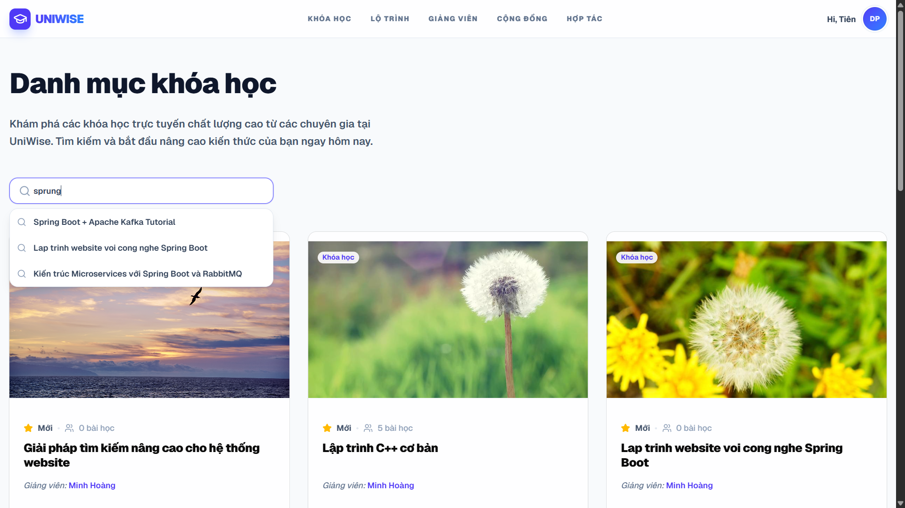
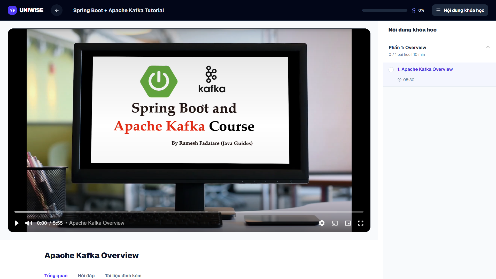
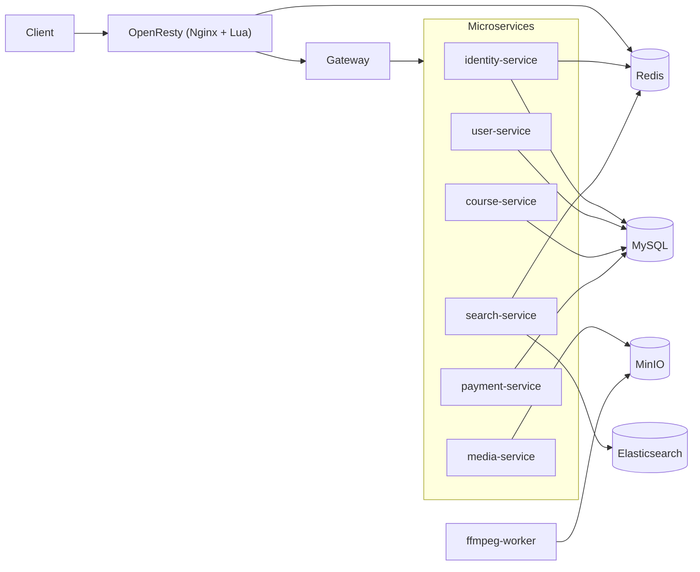
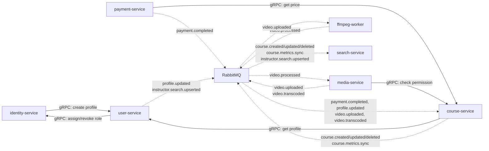

# Uniwise

**English** | [Tiếng Việt](README.md)

Event-driven microservices backend for an e-learning platform. Supports course management, VNPay payments, automatic enrollment, full-text search, and asynchronous HLS video transcoding.

> Personal learning project, not designed for production use (see [Known limitations](#known-limitations)).

| Course search (Elasticsearch fuzzy search) | HLS video lecture player |
|---|---|
|  |  |

[Watch system demo video](https://drive.google.com/file/d/19zzswi93my3UNmRU_v1bg32e9hJI_vY8/view?usp=sharing)

## Tech Stack

Java 21, Spring Boot 4.1.2, Spring Security, Spring Data JPA (Hibernate), Flyway, MapStruct, gRPC, RabbitMQ, Redis, MySQL, Elasticsearch, MinIO, OpenResty (Lua), FFmpeg, Docker Compose.

## Key Features

- Registration, login, refresh token rotation with reuse detection, and RBAC (`USER` / `INSTRUCTOR` / `ADMIN`)
- User profiles and instructor application workflow (`PENDING`, `APPROVED`, `REJECTED`, `SUSPENDED`)
- Course, section, and lesson management with free/paid enrollment and learning progress tracking
- Full-text course and instructor search powered by Elasticsearch, synchronized asynchronously via RabbitMQ
- VNPay sandbox checkout with IPN verification and automatic course enrollment upon successful payment
- Ownership-checked video uploads with asynchronous FFmpeg transcoding to HLS (`.m3u8`/`.ts`)

## Architecture

**High-Level Architecture**



*Arrows to data stores indicate read/write access by each component.*

**Inter-Service Communication**



*Solid lines: synchronous gRPC calls. Dashed lines: asynchronous events via RabbitMQ.*

| Service | Role |
|---|---|
| OpenResty (Nginx + Lua) | Validates Redis tokens, signs internal JWT |
| gateway | Routes requests to backend microservices |
| identity-service | Accounts, sessions, and role-based access control |
| user-service | User profiles and instructor applications |
| course-service | Courses, enrollments, and learning progress |
| media-service | Video upload, HLS streaming, MinIO storage |
| payment-service | Payment creation and VNPay IPN handling |
| search-service | Elasticsearch indexing and full-text search |
| ffmpeg-worker | Asynchronous video transcoding to HLS |

Infrastructure: MySQL, Redis, RabbitMQ, MinIO, Elasticsearch, and an FFmpeg container; services communicate via REST, gRPC, and RabbitMQ.

## Technical Highlights

### 1. Authentication & Authorization (Opaque Token + Edge JWT)
- `identity-service` issues opaque access tokens (SHA-256 hash stored in Redis, 15-minute TTL) and refresh tokens with reuse detection (revoking the entire session if a consumed token is replayed).
- OpenResty validates the opaque token against Redis at the edge, strips client `Authorization`/`X-Auth-Token` headers, and signs a short-lived internal RS256 JWT (`X-Auth-Token`, 5-minute TTL) verified statelessly by downstream services via `public.pem`.
- **Why this design**: enables immediate revocation on logout, account suspension, or role changes without requiring every microservice to query Redis or the database on each request.

### 2. VNPay Payment & Enrollment
- `payment-service` fetches the authoritative price from `course-service` via gRPC (preventing client-side price tampering), stores a `PENDING` transaction, and generates an HMAC-SHA512 signed VNPay URL.
- On IPN callback, the service verifies the signature in constant time, checks `vnp_TmnCode` and exact amount (`amount * 100`), and applies a pessimistic write lock (`FOR UPDATE`) to serialize concurrent IPN callbacks.
- Only after the database transaction commits (`afterCommit`) is `payment.completed` published to RabbitMQ, where `course-service` performs idempotent enrollment (with 3x retry and DLQ).
- **Why this design**: decouples payment confirmation from enrollment for better fault isolation and safe handling of duplicate IPN callbacks.

### 3. Asynchronous Video Transcoding to HLS
- `media-service` verifies lesson ownership via gRPC, uploads the raw video to MinIO (`tmp/`), and publishes `media.video.uploaded` (cleaning up the temporary object if publishing fails).
- `ffmpeg-worker` probes video duration with `ffprobe`, transcodes to HLS segments under `processed/`, and notifies `media-service` to relocate files to `lessons/` and trigger `course-service` to mark the lesson `READY`.
- **Why this design**: offloads CPU-intensive transcoding to a dedicated worker so upload APIs stay responsive without impacting core business services.

## Getting Started

Prerequisites: Docker, Docker Compose (all services and internal libraries are built inside Docker; JDK 21 is only required when running services locally outside Docker).

```bash
docker network create uniwise-net   # first run only
docker compose -p uniwise up -d --build
curl http://localhost/health        # returns OK
```

Default Admin account (auto-created only in `dev`/`docker` profiles): `admin@uniwise.com` / `00000000`.

<details>
<summary>Configuration details</summary>

- **Health check**: `docker compose -p uniwise ps` and `curl http://localhost/health`
- **Local development outside Docker (requires JDK 21)**:
  - Linux / macOS / WSL / Git Bash: run `./build-libs.sh` to verify `.proto` sync and install `platforms/java/libs` to your local Maven repo.
  - Windows (PowerShell): use `startup.ps1` to start Docker infrastructure, build `platforms/java/libs`, and launch the services.
- **Exposed ports (`docker-compose.yaml`)**:
  - Entry point: OpenResty `80`
  - Infrastructure bound to `127.0.0.1` only: MySQL `3306`, Redis `6379`, RedisInsight `5540`, RabbitMQ `5672`/`15672`, MinIO `9000`/`9001`, Elasticsearch `9200`/`9300`, Kibana `5601`
- **Admin account (`ADMIN_EMAIL`, `ADMIN_PASSWORD`)**:
  - `identity-service` reads `ADMIN_EMAIL` and `ADMIN_PASSWORD` during startup in `dev`/`docker` profiles, taking effect only if the account does not yet exist in the database.
  - `docker-compose.yaml` does not currently forward these two variables to `identity-service`; add them under its `environment` section to override when running with Docker Compose.
- **VNPay sandbox**:
  - Configurable via `VNPAY_TMN_CODE`, `VNPAY_HASH_SECRET`, and `VNPAY_RETURN_URL` (already declared for `payment-service` in `docker-compose.yaml`).

</details>

## Known Limitations

| Limitation | Mitigation |
|---|---|
| Infrastructure passwords (MySQL, Redis, RabbitMQ, MinIO, Elasticsearch) and the default admin password are hardcoded in dev configs (infrastructure ports are bound to `127.0.0.1`). | Move all secrets to an untracked `.env` file or secret manager and generate strong random credentials for real deployments. |
| Updating a password (`AccountServiceImpl.update`) does not revoke active sessions or refresh tokens. | Revoke all active sessions for the account and delete Redis `access:*` and `session:*` keys upon password change. |
| `GET /api/v1/courses/published` returns `CourseResponse` including lesson lists without masking `contentReference` for unenrolled users. | Use a summary DTO for list endpoints or mask `contentReference` on paid lessons as done in the course detail endpoint. |
| `ffmpeg-worker` runs as `root` and mounts `/var/run/docker.sock` to run `docker exec` against the `ffmpeg` container. | Install FFmpeg directly in the worker image, run as a non-root user, and remove the `docker.sock` mount. |
| If RabbitMQ fails right after a payment commits to the database, `payment.completed` may be lost and the student will not be enrolled. | Implement the Transactional Outbox pattern: persist the event within the same DB transaction and relay it via a background job. |
| The video pipeline is not fully idempotent: `VideoProcessedConsumer` deletes each source file immediately after copying (a mid-way retry clears the destination and loses moved files), and `ffmpeg-worker` swallows exceptions instead of retrying. | Delete source files only after all segments are copied and verified; rethrow worker exceptions so RabbitMQ handles retries properly. |
| `media-service` and `ffmpeg-worker` lack bounded retry and DLQ; the 3 course-sync queues in `search-service` have retry enabled but no DLQ. | Enable `retry`, set `default-requeue-rejected=false`, and declare DLQs consistently as implemented in `course-service`. |
| Video URLs stored in `Lesson.contentReference` point directly to MinIO even though `StreamingController` already enforces access checks via gRPC. | Point lesson URLs to `/media-service/api/v1/streaming/...` or issue short-lived signed URLs with a private MinIO bucket. |

## Future Work

- Add unit and integration tests for core flows (authentication, payment, enrollment) with GitHub Actions CI
- Implement the Transactional Outbox pattern for payment events and standardize retry/DLQ across all consumers
- Migrate sensitive settings to secret management and serve lesson videos through the authenticated streaming endpoint
