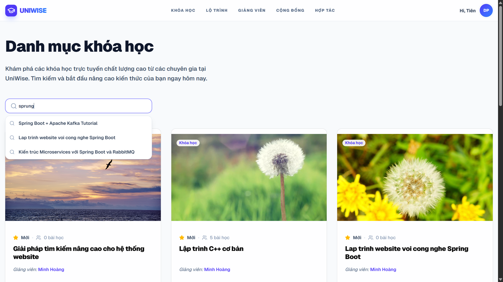
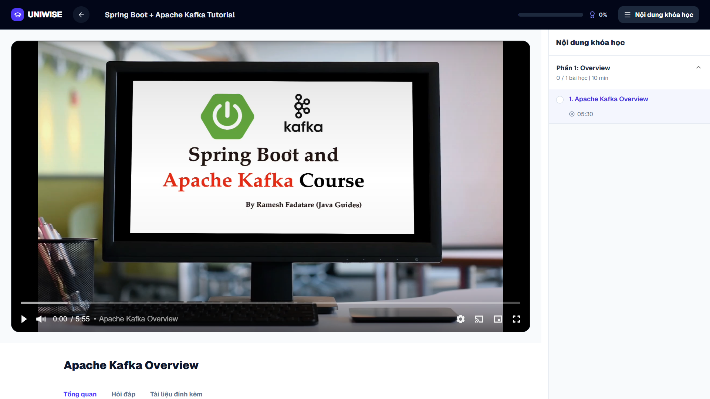
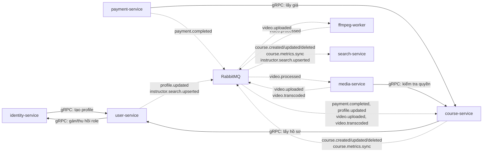

# Uniwise

[English](README.en.md) | **Tiếng Việt**

Backend nền tảng học trực tuyến (e-learning) xây dựng theo kiến trúc microservices hướng sự kiện. Hỗ trợ quản lý khóa học, thanh toán VNPay, ghi danh tự động, tìm kiếm toàn văn và chuyển mã video HLS.

> Dự án cá nhân phục vụ mục đích học tập, chưa được thiết kế cho môi trường production (xem [Known limitations](#known-limitations)).

| Tìm kiếm khóa học (Elasticsearch fuzzy search) | Trình phát bài giảng video HLS |
|---|---|
|  |  |

[Xem video demo hệ thống](https://drive.google.com/file/d/19zzswi93my3UNmRU_v1bg32e9hJI_vY8/view?usp=sharing)

## Công nghệ

Java 21, Spring Boot 4.1.2, Spring Security, Spring Data JPA (Hibernate), Flyway, MapStruct, gRPC, RabbitMQ, Redis, MySQL, Elasticsearch, MinIO, OpenResty (Lua), FFmpeg, Docker Compose.

## Tính năng chính

- Đăng ký, đăng nhập, refresh token có phát hiện tái sử dụng, phân quyền RBAC (`USER` / `INSTRUCTOR` / `ADMIN`)
- Hồ sơ người dùng và quy trình xét duyệt giảng viên (`PENDING`, `APPROVED`, `REJECTED`, `SUSPENDED`)
- Tạo, quản lý khóa học, chương, bài học, ghi danh miễn phí/trả phí và theo dõi tiến độ học
- Tìm kiếm khóa học và giảng viên toàn văn bằng Elasticsearch, đồng bộ bất đồng bộ qua RabbitMQ
- Thanh toán qua VNPay sandbox, xác thực IPN và tự động ghi danh sau khi thanh toán thành công
- Upload video có kiểm tra quyền sở hữu, chuyển mã bất đồng bộ sang HLS (`.m3u8`/`.ts`) qua FFmpeg

## Kiến trúc

**Kiến trúc tổng quát**

```mermaid
flowchart LR
    Client["Client"] --> OpenResty["OpenResty (Nginx + Lua)"] --> Gateway["Gateway"] --> Microservices
    subgraph Microservices
        identity["identity-service"]
        user["user-service"]
        course["course-service"]
        payment["payment-service"]
        media["media-service"]
        search["search-service"]
    end
    ffmpeg["ffmpeg-worker"]
    OpenResty & identity & search --> Redis[("Redis")]
    identity & user & course & payment --> MySQL[("MySQL")]
    media & ffmpeg --> MinIO[("MinIO")]
    search --> ES[("Elasticsearch")]
```



*Mũi tên tới kho dữ liệu thể hiện service đọc/ghi kho đó.*

**Giao tiếp giữa các service**



*Nét liền: gọi đồng bộ gRPC. Nét đứt: sự kiện bất đồng bộ qua RabbitMQ.*

| Service | Vai trò |
|---|---|
| OpenResty (Nginx + Lua) | Xác thực token Redis, ký JWT nội bộ |
| gateway | Định tuyến request tới các microservice |
| identity-service | Tài khoản, phiên đăng nhập, phân quyền |
| user-service | Hồ sơ người dùng và giảng viên |
| course-service | Khóa học, ghi danh, tiến độ học |
| media-service | Upload, streaming HLS, lưu trữ MinIO |
| payment-service | Tạo giao dịch và IPN VNPay |
| search-service | Đồng bộ, tìm kiếm trên Elasticsearch |
| ffmpeg-worker | Chuyển mã video sang định dạng HLS |

Hạ tầng: MySQL, Redis, RabbitMQ, MinIO, Elasticsearch, container FFmpeg; các service giao tiếp qua REST, gRPC và RabbitMQ.

## Điểm nhấn kỹ thuật

### 1. Đăng nhập và xác thực (Opaque token + Edge JWT)
- `identity-service` cấp opaque access token (lưu hash SHA-256 trong Redis, TTL 15 phút) và refresh token có phát hiện tái sử dụng (thu hồi toàn bộ phiên nếu token cũ bị dùng lại).
- OpenResty tra Redis ở lớp biên, xóa header `Authorization`/`X-Auth-Token` từ client rồi ký JWT RS256 nội bộ (`X-Auth-Token`, TTL 5 phút) để service đích xác thực stateless bằng `public.pem`.
- **Vì sao thiết kế như vậy**: thu hồi quyền ngay lập tức khi logout, khóa tài khoản hoặc đổi vai trò, nhưng vẫn tránh việc từng microservice phải truy vấn DB/Redis cho mỗi request.

### 2. Thanh toán VNPay và ghi danh
- `payment-service` gọi gRPC sang `course-service` để lấy giá gốc (tránh giả mạo giá từ client), lưu giao dịch `PENDING` và tạo URL VNPay ký HMAC-SHA512.
- Khi nhận IPN, service xác thực chữ ký (constant-time), kiểm tra `vnp_TmnCode` và số tiền (`amount * 100`), khóa bi quan dòng giao dịch (`FOR UPDATE`) để chống xử lý trùng khi IPN gọi đồng thời.
- Sau khi DB commit (`afterCommit`), sự kiện `payment.completed` mới được gửi qua RabbitMQ để `course-service` ghi danh idempotent (có retry 3 lần và DLQ).
- **Vì sao thiết kế như vậy**: tách biệt xác nhận thanh toán với ghi danh để giảm ghép nối giữa hai service và đảm bảo an toàn khi IPN bị gọi lặp lại.

### 3. Xử lý video bất đồng bộ sang HLS
- `media-service` kiểm tra quyền sở hữu bài học qua gRPC, tải file thô lên MinIO (`tmp/`) và phát `media.video.uploaded` (tự dọn file tạm nếu gửi RabbitMQ lỗi).
- `ffmpeg-worker` đo thời lượng bằng `ffprobe`, chuyển mã sang HLS vào `processed/`, rồi `media-service` chuyển sang `lessons/` và báo `course-service` cập nhật trạng thái bài học thành `READY`.
- **Vì sao thiết kế như vậy**: đẩy tác vụ transcode tốn CPU ra worker riêng giúp API upload phản hồi nhanh và không làm nghẽn các service nghiệp vụ.

## Chạy dự án

Yêu cầu: Docker, Docker Compose, JDK 21.

```bash
./build-libs.sh
docker network create uniwise-net   # chỉ cần chạy lần đầu
docker compose -p uniwise up -d --build
```

Tài khoản Admin mặc định (chỉ tự tạo ở profile `dev`/`docker`): `admin@uniwise.com` / `00000000`.

<details>
<summary>Chi tiết cấu hình</summary>

- **Kiểm tra hệ thống**:
  - Xem trạng thái container: `docker compose -p uniwise ps`
  - Kiểm tra OpenResty health check: `curl http://localhost/health` (trả về `OK`)
- **Danh sách cổng (`docker-compose.yaml`)**:
  - Entry point: OpenResty `80`
  - Hạ tầng chỉ bind `127.0.0.1`: MySQL `3306`, Redis `6379`, RedisInsight `5540`, RabbitMQ `5672`/`15672`, MinIO `9000`/`9001`, Elasticsearch `9200`/`9300`, Kibana `5601`
- **Tài khoản Admin (`ADMIN_EMAIL`, `ADMIN_PASSWORD`)**:
  - `identity-service` đọc `ADMIN_EMAIL` và `ADMIN_PASSWORD` khi khởi tạo ở profile `dev`/`docker`, chỉ có tác dụng khi tài khoản chưa tồn tại trong CSDL.
  - Hiện `docker-compose.yaml` chưa truyền 2 biến này vào `identity-service`; cần khai báo thêm trong mục `environment` nếu muốn ghi đè khi chạy bằng Docker Compose.
- **Thanh toán VNPay (sandbox)**:
  - Có thể ghi đè qua biến môi trường `VNPAY_TMN_CODE`, `VNPAY_HASH_SECRET`, `VNPAY_RETURN_URL` (đã khai báo cho `payment-service` trong `docker-compose.yaml`).

</details>

## Known limitations

| Hạn chế | Hướng giải quyết |
|---|---|
| Mật khẩu hạ tầng (MySQL, Redis, RabbitMQ, MinIO, Elasticsearch) và admin mặc định được ghi trực tiếp trong cấu hình dev (cổng hạ tầng đã bind `127.0.0.1`). | Chuyển toàn bộ secret sang `.env` (không commit) hoặc secret manager và dùng mật khẩu ngẫu nhiên khi triển khai thật. |
| Đổi mật khẩu (`AccountServiceImpl.update`) chưa thu hồi các session/refresh token đang hoạt động. | Thu hồi toàn bộ session của tài khoản và xóa các key Redis `access:*`, `session:*` sau khi đổi mật khẩu. |
| `GET /api/v1/courses/published` trả về `CourseResponse` kèm danh sách bài học chưa ẩn `contentReference` với người chưa ghi danh. | Dùng DTO tóm tắt cho API danh sách hoặc ẩn `contentReference` cho bài học trả phí tương tự API chi tiết khóa học. |
| `ffmpeg-worker` chạy bằng user `root` và mount `/var/run/docker.sock` để gọi `docker exec` sang container `ffmpeg`. | Cài FFmpeg trực tiếp trong image của worker, chạy bằng user non-root và bỏ mount `docker.sock`. |
| Nếu RabbitMQ lỗi sau khi giao dịch thanh toán commit, sự kiện `payment.completed` có thể bị mất khiến học viên chưa được ghi danh. | Áp dụng Transactional Outbox: ghi sự kiện vào bảng trong cùng transaction DB và dùng job nền gửi lại tới khi thành công. |
| Luồng video chưa idempotent: `VideoProcessedConsumer` xóa từng file nguồn ngay khi copy (lỗi giữa chừng rồi retry sẽ xóa thư mục đích gây mất file), còn `ffmpeg-worker` nuốt exception nên không retry. | Chỉ xóa file nguồn sau khi copy đầy đủ tất cả segment; không nuốt exception ở worker để RabbitMQ retry đúng cách. |
| `media-service` và `ffmpeg-worker` chưa có retry giới hạn và DLQ; 3 queue đồng bộ khóa học ở `search-service` đã có retry nhưng chưa có DLQ. | Bật `retry`, đặt `default-requeue-rejected=false` và khai báo DLQ thống nhất như đã làm ở `course-service`. |
| URL video lưu trong `Lesson.contentReference` trỏ trực tiếp tới MinIO dù `StreamingController` đã có kiểm tra quyền qua gRPC. | Trả về URL đi qua `/media-service/api/v1/streaming/...` hoặc dùng signed URL ngắn hạn với bucket private. |

## Hướng phát triển

- Bổ sung unit test và integration test cho các luồng cốt lõi (xác thực, thanh toán, ghi danh) kèm CI trên GitHub Actions
- Áp dụng Transactional Outbox cho sự kiện thanh toán và chuẩn hóa retry/DLQ cho toàn bộ consumer
- Chuyển cấu hình nhạy cảm sang secret management và phát video qua endpoint streaming có kiểm tra quyền
